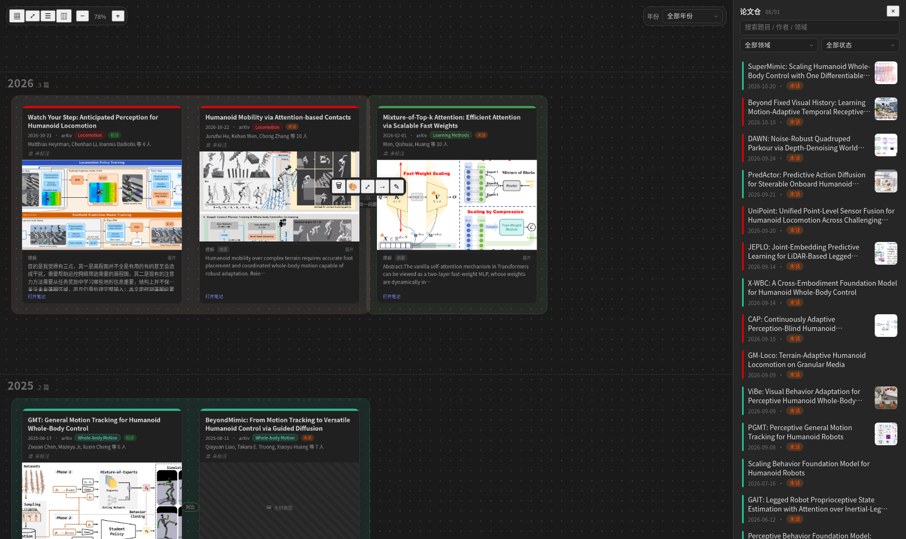
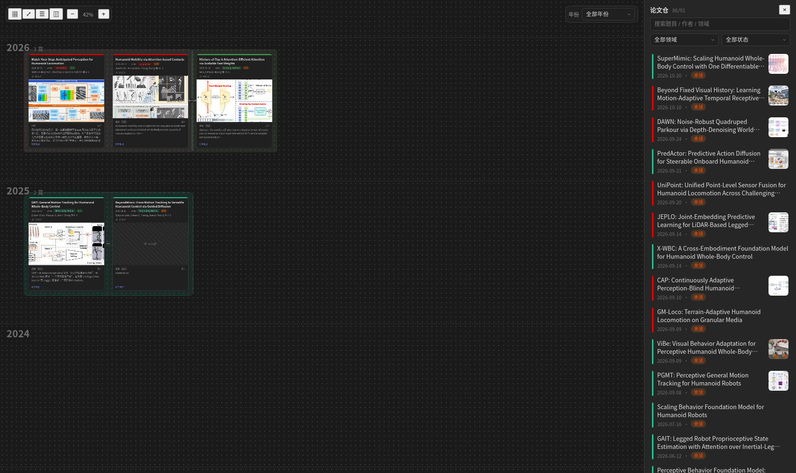
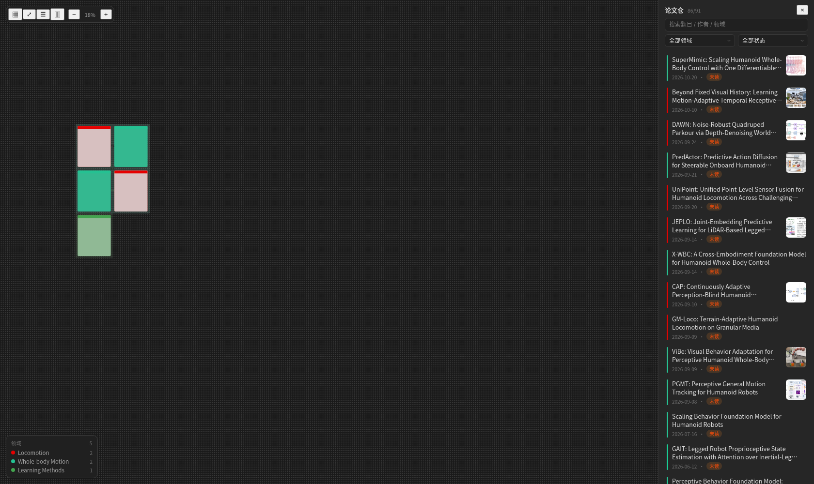
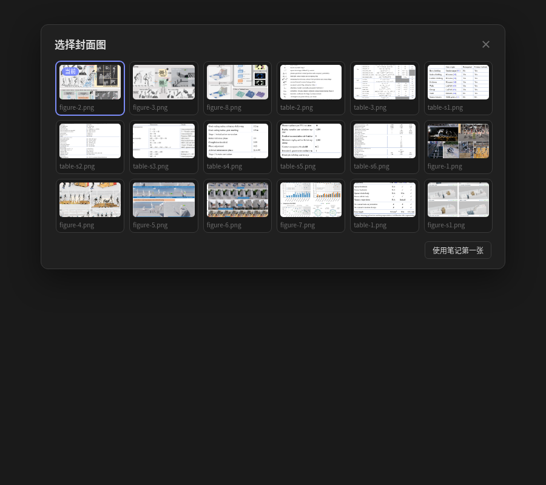

# Paper Atlas · 论文图谱

把论文库画成一张可以拖、可以连线的巨大画布。每篇论文是一张自动生成的卡片，右侧论文仓一拖即入。

> 这是为 `30_References/Paper/manager` 里那 91 篇论文笔记定制的 Obsidian 插件，独立于 `obsidian-mypaper-plugin`（只读取它的领域配色，不改它任何数据）。

## 它长什么样



卡片会一直保持完整，只有缩到 30% 以下才退化成领域色块，左下角图例告诉你每种颜色是哪个领域：





封面图从笔记里的图片中挑，当前封面有标记：



> 截图由测试环境渲染，Obsidian 里的图标是正常图标，不是截图里的占位符号。

```
┌──────────────────────────────────────────────┬──────────────┐
│ 布局  适应视图  图例  论文仓      − 100% +   │ 🔍 搜索       │
│                                              │ 领域 ▾ 状态 ▾ │
│   ┌────────────┐        ┌────────────┐       │ ┌──────────┐ │
│   │ ▎Whole-body│───────▶│ ▎Locomotion│       │ │ 缩略卡片  │ │
│   │ 题目        │  改进  │ 题目        │       │ └──────────┘ │
│   │ 日期 · 状态 │        │ 日期 · 状态 │       │ ┌──────────┐ │
│   └────────────┘        └────────────┘       │ │ 缩略卡片  │ │
└──────────────────────────────────────────────┴──────────────┘
```

## 功能

- **自绘画布**：无限平移缩放，不依赖 Obsidian 原生 Canvas，`.pcanvas` 是自己的 JSON 格式。
- **右侧论文仓**：扫描论文目录，生成缩略卡；搜索、按领域/阅读状态筛选；**拖进画布**即落卡（双击落在视口中央），已经在画布上的论文会自动从列表里消失，列表只留还没放上去的。
- **卡片六要素**：题目 → 时间/会议/领域/状态 → 作者 → 机构 → 封面图（宽度固定，按原图比例完整显示、高度随图不同）→ 理解。主领域是和时间同一行的小胶囊，和「未读」并排。全部来自笔记，且**每一行都能在卡片上直接改**（改动存画布，不回写笔记，随时可"恢复为笔记内容"）。
- **封面**：默认取笔记里第一张图，右键可换；也可以选择"使用笔记第一张"还原。
- **理解**：优先读 `## 理解`，没有就退到 `## 笔记` 首段，再没有退到摘要前 140 字，并在卡片上标明来源；双击理解会用弹窗编辑，不会把卡片撑高。会自动清掉 `%% AI:BEGIN %%`、`<!-- -->`、`==高亮==`、`✦`、`〔AI 生成〕` 这些标记，但**保留标记包住的内容**。
- **手动关系连线**：卡片上下左右四个边都有连接点，拖到另一张卡即建立带箭头的连线；点击连线会浮出工具栏（删除 / 颜色 / 聚焦两端 / 切换箭头方向 / 编辑标签），双击线也能直接写标签。
- **语义缩放**：缩小时卡片按比例整体缩小、始终是完整卡片（题目、作者、图、理解都在），只有缩到 30% 以下才退化成领域色块；左下角图例告诉你色块属于哪个领域，不会再缩成一片灰。
- **年份横线**：画布上有 2015–今年（默认）的水平分隔线，2015 在最上面、今年在最下面，年份写在两条线之间的左上角；拖动横线可以加宽某一年的空间。右上角「年份」下拉框可以一键聚焦到某一年，右键横线也能聚焦/删除/重建。
- **自动布局**：按领域聚类排列，外围有淡色虚线框（只有颜色、没有文字标签），领域本身写在卡片状态行的小胶囊里；布局只影响新卡片和你主动点"布局"的那次。
- **实时同步**：笔记改了、从「未阅读」挪到「已阅读」并改了文件名，画布上的卡片会跟着更新，不会失联。
- **撤销/重做**：`Ctrl/Cmd+Z`、`Ctrl/Cmd+Shift+Z`。

## 安装

插件已经构建好（`main.js` 已生成），只需：

1. Obsidian → 设置 → 第三方插件 → 已安装插件列表右下角点刷新；
2. 找到 **Paper Atlas**，启用；
3. 左侧栏点网络图标，或命令面板搜「打开论文图谱」。

> 插件目录：`.obsidian/plugins/paper-atlas/`

## 首次使用

1. 打开画布，右侧论文仓能看到 91 篇；
2. 想一次性铺满：点画布中央的「铺开全部论文」（或命令面板 → `画布：铺开全部论文`）；
3. 只想放几篇：从右侧直接拖进画布；
4. 点「适应视图」（`Shift+1`）看全局。

## 操作

| 操作 | 方式 |
| --- | --- |
| 平移 | 空格 + 拖拽 / 中键拖拽 / 双指滑动 |
| 缩放 | `Ctrl`（或 `Cmd`）+ 滚轮，或工具栏 `+` / `-` |
| 适应视图 | 工具栏按钮，或 `Shift+1` |
| 移动卡片 | 直接拖 |
| 调整大小 | 卡片右下角 |
| 框选 | 在空白处拖框 |
| 多选 | `Shift` / `Ctrl` / `Cmd` + 点击 |
| 建立关系 | 悬停卡片边缘 → 拖动圆点到另一张卡 |
| 改连线标签 | 双击连线，或右键 → 编辑标签 |
| 改卡片内容 | 双击对应那一行；或右键 → 编辑 |
| 换封面 | 悬停封面右上角「更换封面」，或右键 |
| 打开原笔记 | 卡片底部「打开笔记」，或右键 |
| 删除 | 选中后 `Delete` / `Backspace`（可撤销） |
| 撤销 / 重做 | `Ctrl+Z` / `Ctrl+Shift+Z` |

## 卡片数据从哪来

| 卡片行 | 来源 | 现状 |
| --- | --- | --- |
| 题目 | frontmatter `title` | 91/91 |
| 领域 | `fields[0]` / `field` | 91/91 |
| 时间 | `date`（没有就用 `publishDate` / `year` / `added_at`） | 91/91 |
| 会议 | `journal` / `venue` | 大部分 |
| 作者 | `authors` | 91/91 |
| 机构 | `institutions` / `affiliations` | **0/91，显示"未标注"** |
| 封面 | 正文第一张图 / 画布里的选择 | 37/91 |
| 理解 | `## 理解` → `## 笔记` → 摘要 | 1/91 有正式理解 |

机构以后想补：在笔记 frontmatter 里加一行

```yaml
institutions: ["CMU", "NVIDIA"]
```

保存后画布会自动刷新（只要这张卡没被手动改过机构）。

## 数据与备份

- 画布默认存 `30_References/Paper/manager/论文图谱.pcanvas`（纯 JSON，坚果云和 git 都能正常版本管理）。
- 保存先写 `.tmp` 再原子改名，并自动保留上一版 `.bak`；主文件损坏时会从 `.bak` 恢复，且**不会用空白画布覆盖坏文件**。
- 路径可在 设置 → Paper Atlas 里改；改完点「重新扫描」。
- 卡片手动改过的字段以 `overrides` 存在画布节点里，**不会污染论文笔记**。
- 删除论文笔记不会删卡片，卡片会变成"笔记已删除"的虚线状态，方便你恢复或重新挂接。

## 已知限制

- 仅桌面端（拖拽和快捷键依赖鼠标键盘）。
- 原生 Canvas 打不开 `.pcanvas`，这是刻意的取舍：换来自定义颜色、尺寸、折叠、覆盖值。
- 连线没有"自动推荐"，全部手动——这是你选的方案，避免 AI 乱连。
- 卡片上的富文本编辑是"行内输入 + 轻量 Markdown 预览"，不是完整的所见即所得编辑器。

## 开发

```bash
cd .obsidian/plugins/paper-atlas
npm install          # 已装过可跳过
npm run build        # tsc 类型检查 + esbuild 打包出 main.js
npm test             # 91 篇真实笔记的解析测试 + happy-dom 视图集成测试
```

目录：

```
src/
  main.ts               插件入口、命令、设置页
  settings.ts           设置结构与默认值
  types.ts              卡片 / 画布 / 论文的数据类型
  core/
    paper.ts            笔记 → 论文卡片数据（六要素、封面、理解清洗）
    index.ts            论文库扫描与图片解析
    board.ts            .pcanvas 读写与校验
    layout.ts           按领域聚类布局
    colors.ts           领域配色（可继承论文管理器）
    text.ts             日期、清洗、轻量 Markdown
  view/
    AtlasView.ts        画布视图：平移缩放、拖拽、连线、撤销
    card.ts             卡片 DOM
    edges.ts            连线几何
    modals.ts           封面选择器、标签输入
    dom.ts              DOM 小工具
tests/
  run.ts                核心解析测试（真实笔记）
  integration.ts        视图集成测试（happy-dom）
  load.cjs              插件 bundle 加载冒烟测试
```
